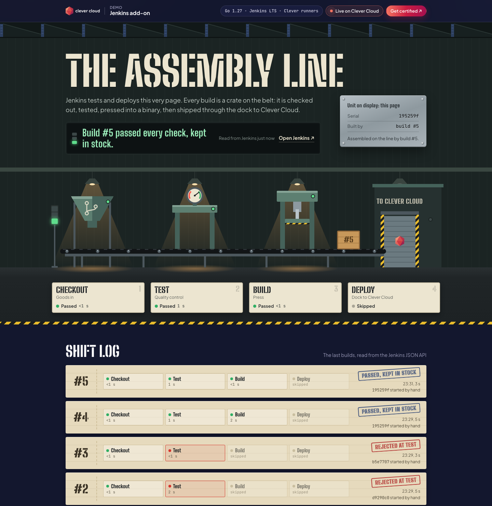
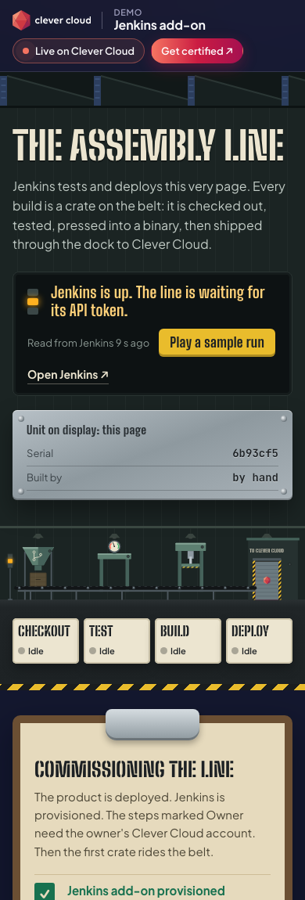

# The Assembly Line — Jenkins on Clever Cloud

> Jenkins tests and deploys this very page. Every build is a crate on a conveyor belt: checked out at goods in, tested at quality control, pressed into a binary, then shipped through the dock to Clever Cloud. The factory floor reads the Jenkins JSON API server side and draws the line live: the stations light up, the press strokes, the dock opens. Go standard library only, the **Jenkins add-on** with **Clever Cloud runners**, dressed in the Clever Brand Kit.
>
> **Before you start.** Deploying the app is not the end: until the section [Connect the line](#connect-the-line-about-10-minutes-owner-of-the-clever-account) is done, in Jenkins opened from the Clever Cloud Console (Clever Cloud SSO, owner of the account), the page says "Waiting for connection" with the step to do, and `/health/deep` answers 503 with the same step. Plan those 10 to 15 minutes before a demo.





**Run it yourself.** The hosted demo was taken down after the presales review (November 2026). The steps in [Deploy on Clever Cloud](#deploy-on-clever-cloud) and [Connect the line](#connect-the-line-about-10-minutes-owner-of-the-clever-account) recreate it from scratch in about 25 minutes: 10 for the app and the Jenkins add-on, 10 to 15 for the owner steps in Jenkins.

**Get certified.** This demo runs on Clever Cloud. To deploy your own apps the same way, get certified at the [Clever Cloud Academy](https://academy.clever.cloud/).

---

## What you see

| On the page | What Jenkins is doing |
|---|---|
| **The line** (four machines and a crate) | The latest build of the `assembly-line` job. Each machine is a stage of the [`Jenkinsfile`](Jenkinsfile): goods in = `Checkout`, quality control = `Test`, the press = `Build`, the dock = `Deploy`. The lamp over a machine lights when its stage runs; the crate stops at the station that failed, stamped "Reject". |
| **Andon board** | One sentence about the line: running, shipped, rejected, waiting. |
| **Unit on display** (riveted plate) | Which build produced the page you are reading: the app matches its own `CC_COMMIT_ID` with the commit each Jenkins build checked out. A deploy done by hand with `clever deploy` says so. |
| **Shift log** (time cards) | The last 8 builds with the time spent at each station, the commit and the trigger. |
| **What the line asks Jenkins** | The exact API calls the Go server made, their status and latency. The token is shown as `••••`: it never leaves the server. |
| **Runners on the floor** | Jenkins agents online right now. On Clever Cloud a runner is a Docker app started for a build, then deleted: you pay for the seconds the build runs. |
| **The blueprint** | The `Jenkinsfile` itself. |
| **Commissioning the line** (clipboard) | Shown until the first build exists: the setup steps, ticked automatically from what the app can read. |

Until Jenkins is connected, **Play a sample run** shows how a crate moves through the four stations. It is labelled as a sample, never as a build.

---

## Deploy on Clever Cloud

You need [clever-tools](https://www.clever.cloud/developers/doc/cli/) (`clever login` done) and the ID of the organisation that will own the resources (`orga_…`, shown in the Console). Run the commands from the repo root: `clever create` links the folder to the new app. Jenkins checks the code out from Git, so push this repository somewhere Jenkins can reach (a fork on GitHub, for example) before step 4 of "Connect the line".

```bash
# 1. The product app and its size
clever create --type go demo-jenkins --org <org_id> --region par
clever scale --min-flavor nano --max-flavor XS --min-instances 1 --max-instances 2
clever scale --build-flavor M

# 2. Jenkins (plan XS, encrypted at rest: Jenkins stores credentials), linked to the app
clever addon create jenkins demo-jenkins-line --plan XS --region par --org <org_id> --option encryption=true --yes
clever service link-addon demo-jenkins-line

# 3. Health check, then the first deploy by hand
clever env set CC_HEALTH_CHECK_PATH /health
clever deploy
clever applications          # note the app id (app_…): the pipeline's PRODUCT_APP_ID
```

The Go runtime builds the module (`go.mod`, Go 1.27) and starts the binary on port 8080. Linking the add-on injects `JENKINS_TUNNEL`: the app reads it to find the Jenkins web address on its own. The page is live straight away, in its "Waiting for connection" state: the andon board names the step to do, and `/health/deep` answers 503 with the state (`awaiting-token`) and that step (`nextStep`) until the read token of step 5 below is set. There is no setup script on the Clever side: the rest happens in Jenkins.

## Connect the line (about 10 minutes, owner of the Clever account)

Jenkins on Clever Cloud signs people in with **Clever Cloud SSO** (SAML through Keycloak). The two tokens below can only be created by a person signed in with their Clever account.

1. **Sign in.** Open the Jenkins add-on in the Console › *Access Jenkins*, or the Jenkins URL. Sign in with your Clever account and accept every permission the first time.
2. **Clever runners.** *Manage Jenkins › Clouds › New cloud › Clever Cloud*. Add a runner template:
   - label `clever-go`,
   - Docker image `jenkins/inbound-agent:latest-jdk21` (it has git and curl; the pipeline downloads Go and clever-tools itself),
   - size XS.
3. **Deploy credentials.** Mint a Clever token pair just for Jenkins, then store it as two *Secret text* credentials (*Manage Jenkins › Credentials › System › Global*):
   ```bash
   CONFIGURATION_FILE="$HOME/jenkins-clever.json" clever login   # a separate pair, revocable on its own
   ```
   Copy `token` into a credential with id `clever-token` and `secret` into one with id `clever-secret`, then delete the file. The pipeline binds them as `CLEVER_TOKEN` and `CLEVER_SECRET`; Jenkins masks them in the console.
4. **The job.** *New Item › Pipeline*, named `assembly-line`. Definition: *Pipeline script from SCM*, Git, your copy of this repository, branch `*/main`, script path `Jenkinsfile`. Then tell the pipeline which app to deploy: *Manage Jenkins › System › Global properties › Environment variables*, add `PRODUCT_APP_ID` = the app id noted above (`app_…`). Without it the Deploy stage stops with an error saying so.
5. **The factory floor's read token.** In Jenkins, *your user › Security › API Token › Add new token*. Your user id is in the address of that page (`/user/<id>/`). Then:
   ```bash
   clever env set JENKINS_USER <your-jenkins-user-id>
   clever env set JENKINS_API_TOKEN <the-token>
   clever restart
   ```
6. **Build Now.** Watch the crate ride the belt. `/health/deep` turns 200.

For production, use a dedicated Clever account with a restricted role for the deploy token, and a dedicated Jenkins user for the read token.

## The pipeline

[`Jenkinsfile`](Jenkinsfile), declarative, four stages, on a Clever runner labelled `clever-go`:

| Stage | Steps |
|---|---|
| Checkout | `checkout scm` |
| Test | `ci/go vet ./...`, `ci/go test ./...` |
| Build | `ci/go build -trimpath -o dist/product .` |
| Deploy | checks that `PRODUCT_APP_ID` is set, `ci/clever link $PRODUCT_APP_ID`, `ci/clever deploy --force --same-commit-policy rebuild` (skipped when the `SHIP` parameter is off) |

`ci/go` and `ci/clever` run the pinned Go toolchain and clever-tools binary, downloading them into `.tools/` on the first call (the runner image ships neither). `clever deploy` waits for Clever Cloud to report the deployment, so the dock lamp turns green only once the new version is live.

## Variables

| Variable | Set by | Role |
|---|---|---|
| `JENKINS_TUNNEL` | Jenkins add-on (linked) | `<host>:<port>` of the agent tunnel. The app keeps the host and talks to `https://<host>`. |
| `JENKINS_USER` | you | Jenkins user id that owns the API token |
| `JENKINS_API_TOKEN` | you | Jenkins API token, used server side with Basic auth, never sent to the browser |
| `JENKINS_JOB` | optional | Pipeline job name, default `assembly-line` |
| `JENKINS_URL` | optional | Overrides the address read from `JENKINS_TUNNEL` (another Jenkins, local tests) |
| `CC_HEALTH_CHECK_PATH` | you | `/health` |
| `PRODUCT_APP_ID` | you, **in Jenkins** (global environment variable, not on the app) | The Clever app the pipeline's Deploy stage links and deploys |

The "Running on Clever Cloud" panel shows `CC_APP_NAME`, `APP_ID`, `INSTANCE_NUMBER`, `INSTANCE_TYPE`, `CC_PRETTY_INSTANCE_NAME`, `CC_COMMIT_ID` and `CC_DEPLOYMENT_ID`, nothing else.

## Routes

| Route | |
|---|---|
| `GET /` | The factory floor (server-rendered, then refreshed every 5 s) |
| `GET /api/floor` | The same reading as JSON |
| `GET /health` | 200, never touches Jenkins |
| `GET /health/deep` | 200 when the Jenkins API answers with the token, 503 with the reason and the step to do (`nextStep`) otherwise |

Jenkins is read at most once every 4 s whatever the number of viewers (every 15 s while it is not connected). The calls: `/job/<job>/api/json` (builds, commit, trigger), `/job/<job>/wfapi/runs` (stages, Pipeline Stage View plugin) with a fallback to `/job/<job>/<n>/stages/tree` (Pipeline Graph View plugin), `/computer/api/json` (runners), `/label/clever-go/api/json` (runner template configured) and the credential ids (never their values).

## Local development

```bash
go test ./...                               # 12 tests, fixtures recorded from a real Jenkins 2.580.2
PORT=8471 go run .                          # http://localhost:8471, "no Jenkins linked"
PORT=8471 JENKINS_URL=http://localhost:8472 JENKINS_USER=admin JENKINS_API_TOKEN=… go run .
```

A local Jenkins: `brew install jenkins-lts`, plugins *Pipeline*, *Git*, *Pipeline: Stage View* and *Pipeline Graph View*, the built-in node labelled `clever-go`, and the job pointed at a clone of this repository. Run it with the `SHIP` parameter off: the Deploy stage is skipped.

## Project structure

```
main.go        → HTTP server, routes, security headers, health checks
jenkins.go     → Jenkins JSON API client (Basic auth, call log, 4 s cache)
floor.go       → stages → stations, outcomes, andon sentence, checklist, unit plate
config.go      → JENKINS_* and CC_* variables
main_test.go   → httptest suite against a fake Jenkins replaying testdata/
web/           → page template, factory art (inline SVG), floor.css, app.js, brand kit files
Jenkinsfile    → the pipeline
ci/go, ci/clever → pinned toolchains for the runner
```

## Recreate the Jenkins add-on

The Jenkins add-on (plan XS, about 20 € per month) is deleted after the demo review. To bring the line back: run the `clever addon create jenkins …` and `clever service link-addon …` commands above, `clever restart`, then the six steps of "Connect the line" (the new Jenkins starts empty, `PRODUCT_APP_ID` included). The product app keeps working on its own in the meantime and shows "No Jenkins linked to this line."

## License

[MIT](LICENSE) © 2026 [Vitiosum](https://github.com/Vitiosum)
